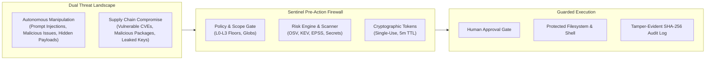
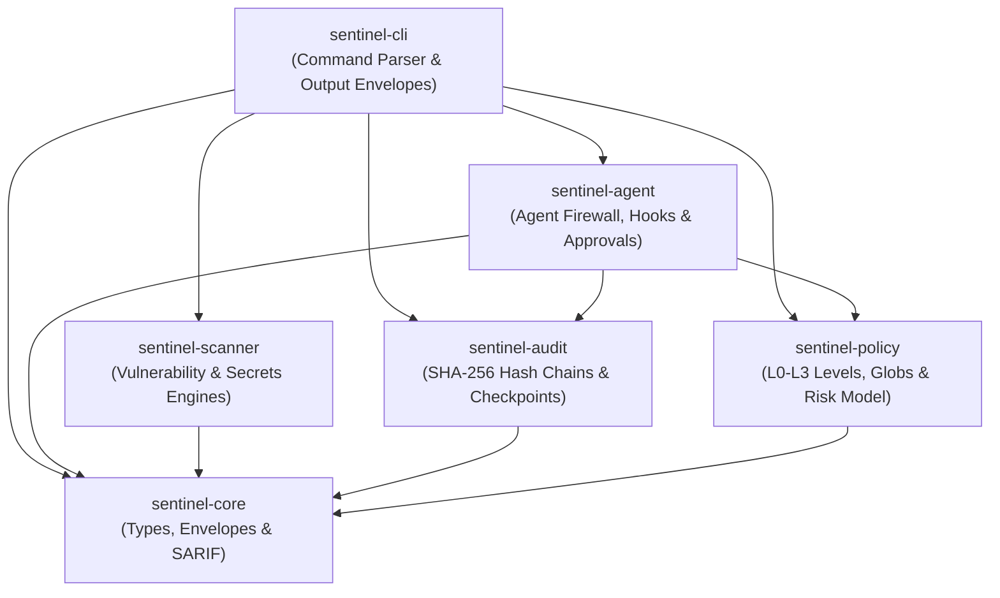

# Sentinel: Pre-Action Security Firewall for AI Coding Agents

[](https://github.com/adriennie/Sentinel-cli/actions/workflows/ci.yml)
[](Cargo.toml)
[](LICENSE)
[](docs/policy-reference.md)
[](docs/architecture.md)

Sentinel is a high-performance, local-first security policy gate, dependency vulnerability scanner, and cryptographic audit engine designed to secure AI coding agents (**Anthropic Claude Code**, **OpenAI Codex**, and **GitHub Copilot**) and development workflows.

Sentinel evaluates agent actions **before execution occurs**, deterministically blocking unauthorized writes, catching exposed credentials and supply-chain vulnerabilities, enforcing human-in-the-loop approvals, and recording tamper-evident audit trails.

---

## The Problem: The AI Coding Agent Trust Gap

Autonomous coding agents are routinely granted broad filesystem and shell privileges to build features and refactor code. This creates a critical dual-threat landscape:



1. **Autonomous Agent Manipulation**: Indirect prompt injections from untrusted repo files, issues, or web lookups can commandeer an agent's control loop, driving it to run destructive shell commands (`rm -rf`, curl-pipe-bash) or overwrite sensitive security configurations.
2. **Software Supply Chain Risks**: Agents frequently add dependencies without validating vulnerability databases, introducing typo-squatted packages or known CVEs.
3. **The Sandbox Fallacy**: OS sandboxes (Docker, VMs) isolate processes but lack semantic understanding of agent intent, tool protocols, and fine-grained repository policies. SAST tools run after the fact in CI—long after damage has occurred on the developer's workstation.

Sentinel acts as the **governance and authorization firewall** between the AI agent and your machine.

---

## System Architecture

Sentinel is organized as a modular, high-performance Rust workspace:



- **[`sentinel-cli`](docs/cli-reference.md)**: Entrypoint CLI, subcommand routing, and standardized JSON/SARIF output envelopes.
- **[`sentinel-policy`](docs/policy-reference.md)**: Strict schema validation (`sentinel.yml`), path glob matching, and additive risk scoring.
- **[`sentinel-agent`](docs/agent-firewall.md)**: Runtime pre-action hook gate for Claude Code, preview bridges for Codex/Copilot, and approval token lifecycle.
- **[`sentinel-scanner`](docs/vulnerability-scanning.md)**: Native lockfile parsers (Cargo, npm, uv, Poetry, requirements.txt, CycloneDX SBOM), OSV client, EPSS/KEV enrichment, Python reachability, and secrets scanning.
- **[`sentinel-audit`](docs/audit-and-integrity.md)**: Structured JSONL logging, domain-separated SHA-256 hash chaining, and checkpoint verification.
- **[`sentinel-core`](docs/architecture.md)**: Common primitives, path normalization, and OASIS SARIF v2.1.0 data models.

*For complete architectural details, see the [System Architecture Plan](docs/architecture.md).*

---

## Security Levels (L0 to L3)

Sentinel enforces non-bypassable security level floors configured in `sentinel.yml`:

| Level | Mode | Protected Path Writes | Unprotected Writes | Shell & Network Execution |
| :---: | :--- | :--- | :--- | :--- |
| **L0** | **Permissive / Audit** | `log_only` | `allow` | Rule or Default (`allow`) |
| **L1** | **Standard Guarded** *(Default)* | `require_approval` | `allow` | Rule or Default (`allow`) |
| **L2** | **Strict Isolation** | `require_approval` | `allow` (within scope) | **`deny`** (all shell & network blocked) |
| **L3** | **Read-Only Lockdown** | **`deny`** | **`deny`** | **`deny`** (all writes, shell, network blocked) |

*For complete policy schema and rule syntax, see the [Policy Reference Specification](docs/policy-reference.md).*

---

## Core Algorithms & Cryptographic Specifications

Sentinel relies on provably deterministic mathematical models and cryptographic protocols:

### 1. Deterministic Policy Precedence
$$\text{Deny}\ (3) \succ \text{RequireApproval}\ (2) \succ \text{LogOnly}\ (1) \succ \text{Allow}\ (0)$$
The final decision is the supremum of rule evaluation and security level floors:
$$D_{\text{final}} = \max\Big(D_{\text{rules}}, \; D_{\text{floor}}\Big)$$
An explicit denial always overrides approvals, and risk scores **never** grant permissions.

### 2. Additive Risk Scoring Model
$$\text{Score} = \min\Big(10, \; 3 \cdot \mathbb{I}_{\text{protected}} + 4 \cdot \mathbb{I}_{\text{destructive}} + 4 \cdot \mathbb{I}_{\text{secret}} + 2 \cdot \mathbb{I}_{\text{reachable}} + 3 \cdot \mathbb{I}_{\text{kev}} + 2 \cdot \mathbb{I}_{\text{high\_epss}} + 1 \cdot \mathbb{I}_{\text{uncertain}}\Big)$$
Scores are saturated in $[0, 10]$ and quantify the risk of an action or vulnerability.

### 3. Domain-Separated Cryptographic Hash Chaining
$$H_i = \text{SHA-256}\Big(\text{"sentinel-audit-v2\n"} \parallel \text{str}(i) \parallel \text{"\n"} \parallel H_{i-1} \parallel \text{"\n"} \parallel \text{Canonical}(E_i) \parallel \mathcal{A}_i\Big)$$
Canonical JSON enforces recursive key sorting and compact formatting. Truncation attacks are detected via independent external checkpoints.

### 4. Single-Use Cryptographic Approval Tokens
$$\mathcal{B} = \text{SHA-256}\Big(\text{Canonical}\big(\text{agent}, \text{session}, \text{operation}, \text{targets}, \text{args\_hash}, \text{file\_hashes}, \text{scope}, \text{nonce}, \text{policy}\big)\Big)$$
Tokens expire in 300 seconds (5m TTL) and are consumed atomically under advisory file locks (`flock`).

### 5. Conservative Static Reachability
Models dependencies as a directed import graph over Python entrypoints. Evaluates to `reachable`, `unknown`, or `not_analyzed`. Sentinel **never emits `not_reachable`** from the absence of static evidence alone.

*For complete mathematical proofs and algorithms, see the [Algorithmic & Cryptographic Specifications](docs/algorithms.md).*

---

## Supported AI Agent Integrations

| Provider | Integration Status | Interception Mechanism | Hook Failure Mode | Degraded Flag Required? |
| :--- | :---: | :---: | :---: | :---: |
| **Anthropic Claude Code** | **Production Native** | Exec `PreToolUse` hook | **Fail-Closed** (`onFailure: block`) | No |
| **OpenAI Codex** | **Preview / Best-Effort** | Process wrapper bridge | Fail-Open Upstream | **`--allow-degraded-hooks`** |
| **GitHub Copilot CLI** | **Preview / Best-Effort** | Process wrapper bridge | Fail-Open Upstream | **`--allow-degraded-hooks`** |

> [!WARNING]
> Claude Code enforces strict fail-closed blocking via native hooks. OpenAI Codex and GitHub Copilot operate under a preview / best-effort model; because upstream runners fail open on errors, Sentinel explicitly requires `--allow-degraded-hooks` to launch them. Sentinel is a pre-action policy gate, not an operating-system sandbox.

*For full integration details, see the [Agent Firewall Guide](docs/agent-firewall.md).*

---

## 5-Minute Quickstart

### 1. Installation

Install prebuilt binaries via the one-command installer (macOS & Linux):

```sh
curl -fsSL https://raw.githubusercontent.com/adriennie/sentinel-releases/main/install.sh | bash
```

Or install from source with Cargo (requires Rust 1.99.1+):

```sh
cargo install --locked --path crates/sentinel-cli
```

### 2. Initialize Policy

Initialize a repository with standard `L1` security:

```sh
sentinel init --level L1
sentinel policy check
```

### 3. Scan for Vulnerabilities & Secrets

Run dependencies and secrets scanning:

```sh
# Full scan (dependencies + secrets)
sentinel scan

# Dependency-only scan using local offline cache
sentinel scan --type dependencies --offline

# Export SARIF for GitHub Security tab
sentinel scan --format sarif > sentinel.sarif
```

### 4. Guard an AI Coding Agent Session

Configure and launch Anthropic Claude Code under Sentinel supervision:

```sh
# One-time setup: registers fail-closed hook into .claude/settings.json
sentinel agent setup claude

# Verify status
sentinel agent status --provider claude

# Launch guarded session restricted to src/
sentinel guard --scope 'src/**' -- claude
```

### 5. Review & Grant Approvals

When an agent attempts to edit a protected file (e.g. `src/auth/jwt.rs`), Sentinel halts the operation. From a separate terminal:

```sh
# Inspect pending requests and risk scores
sentinel approvals list

# Grant single-use approval (5-minute TTL)
sentinel approvals grant req_8f1a
```
The agent retries the action and Sentinel permits execution under lock.

### 6. Audit & System Health

```sh
# View newest audit events
sentinel audit --limit 20

# Create an external tamper-evident checkpoint
sentinel audit checkpoint --output /var/backups/sentinel-cp.json

# Verify audit hash chain
sentinel audit verify --checkpoint /var/backups/sentinel-cp.json

# Run system diagnostic checks
sentinel doctor
```

---

## Documentation Index

Explore the comprehensive Sentinel documentation suite:

| Document | Description |
| :--- | :--- |
| **[System Architecture](docs/architecture.md)** | Crate boundaries, dependency graphs, data flows, and design principles. |
| **[Algorithmic Specifications](docs/algorithms.md)** | Mathematical models, precedence formulas, hash chaining, reachability lattice, and token binding. |
| **[Threat Model & Security Invariants](docs/threat-model.md)** | Problem statement, dual threat landscape, security invariants, boundaries, and trust assumptions. |
| **[Operational Workflow Plan](docs/workflow-plan.md)** | Step-by-step developer onboarding, agent sessions, approval escalations, audit, and CI/CD pipelines. |
| **[AI Agent Firewall Guide](docs/agent-firewall.md)** | In-depth guide for Claude Code, OpenAI Codex, GitHub Copilot, degraded hooks, and approvals. |
| **[Policy Reference Specification](docs/policy-reference.md)** | Schema v1 reference for `sentinel.yml`, security levels L0-L3, custom rules, and globs. |
| **[Vulnerability & Secrets Scanning](docs/vulnerability-scanning.md)** | Lockfile ecosystem support, OSV API, EPSS/KEV enrichment, Python reachability, and secrets. |
| **[Audit, Integrity & Diagnostics](docs/audit-and-integrity.md)** | JSONL audit store, SHA-256 hash chains, decision journals, external checkpoints, and doctor. |
| **[CLI Reference Manual](docs/cli-reference.md)** | Complete CLI manual, global flags, exit codes 0-8, and machine-readable JSON envelopes. |
| **[Roadmap & Evolution](docs/roadmap.md)** | Combined history of v0.0.1 and v0.0.2 milestones, completed checklists, and future v0.0.3 plans. |
| **[Release Acceptance & Evidence](docs/release-acceptance.md)** | Quality gates, test evidence, packaging, and 4-target verification matrix. |

---

## Verification & Testing

Sentinel is verified against a 4-target CI matrix (**Linux x64**, **Windows x64**, **macOS Intel**, and **Apple Silicon**):

```sh
# Code formatting
cargo fmt --all -- --check

# Strict Clippy validation
cargo clippy --locked --workspace --all-targets -- -D warnings

# Run all 122+ workspace tests
cargo test --locked --workspace

# Run synthetic Codex / Copilot protocol tests
python3 scripts/test-codex-copilot-protocol.py

# Run end-to-end release acceptance
python3 scripts/check-release.py
```

---

## License

Sentinel is licensed under the [MIT License](LICENSE).
