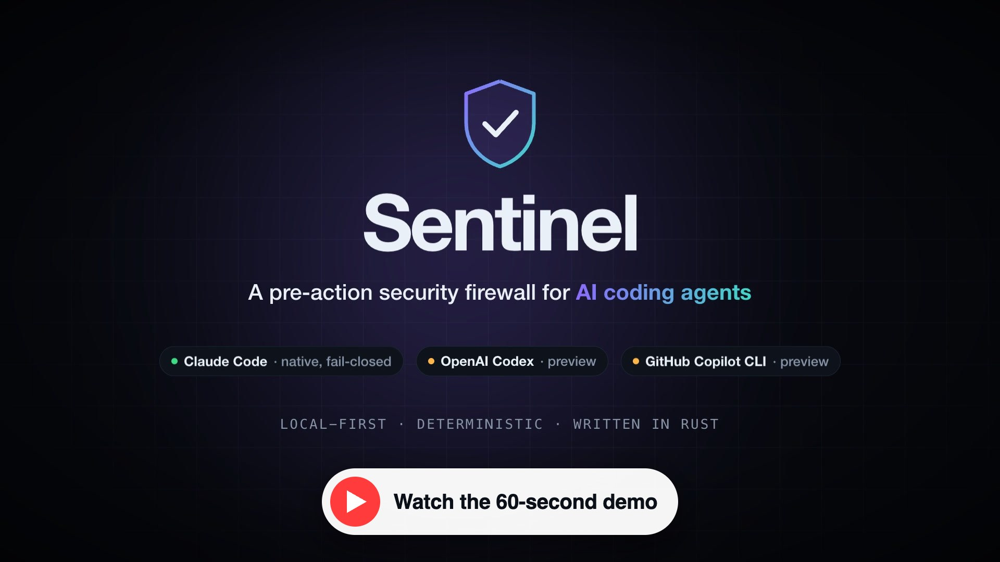
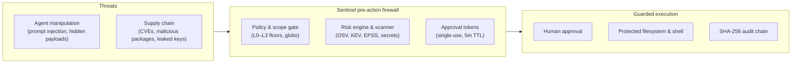
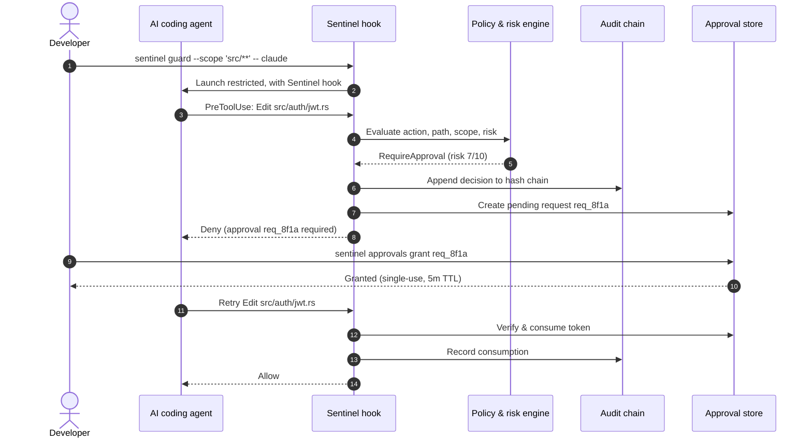
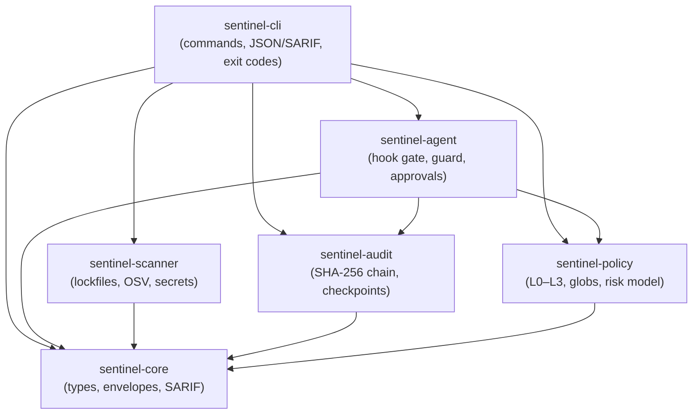

# Sentinel

### A pre-action security firewall for AI coding agents

[](https://github.com/adriennie/Sentinel-cli/actions/workflows/ci.yml)
[](Cargo.toml)
[](LICENSE)
[](docs/policy-reference.md)
[](docs/architecture.md)

[](https://youtu.be/HKS-hIDk2bo)

<p align="center"><b><a href="https://youtu.be/HKS-hIDk2bo">▶ Watch the 60-second demo on YouTube</a></b></p>

AI coding agents (**Claude Code**, **OpenAI Codex**, **GitHub Copilot CLI**) get full access to your filesystem and shell. Nothing checks what they do *before* they do it.

**Sentinel does.** It is a local-first Rust CLI that sits between the agent and your machine. Every file write, shell command and network call is evaluated against your policy **before it runs**, and is then allowed, denied, or held for a human to approve. It also scans dependencies and secrets, and records every decision in a tamper-evident audit log.

```sh
curl -fsSL https://raw.githubusercontent.com/adriennie/sentinel-releases/main/install.sh | bash
```

---

## Contents

- [Why Sentinel](#why-sentinel)
- [What it does](#what-it-does)
- [See it in action](#see-it-in-action)
- [Quickstart](#quickstart)
- [How it works](#how-it-works)
- [Security levels](#security-levels-l0l3)
- [Agent integrations](#agent-integrations)
- [Architecture](#architecture)
- [Core algorithms](#core-algorithms)
- [Documentation](#documentation)
- [Development](#development)

---

## Why Sentinel

Coding agents act fast and with your privileges. That creates three problems:

1. **Prompt injection.** A poisoned README, issue or web page can steer the agent into running `rm -rf`, `curl … | bash`, or rewriting your security config.
2. **Supply-chain risk.** Agents add dependencies without checking them, pulling in known CVEs, typo-squatted packages, or leaked keys.
3. **The sandbox fallacy.** Containers and VMs isolate processes but don't understand agent intent or repo policy. SAST runs in CI, long after the damage happened on your laptop.

Sentinel is the **authorization layer** between the agent and your machine: deterministic, local, and checked before anything executes.



---

## What it does

| | |
| :--- | :--- |
| 🛡️ **Pre-action gate** | Fail-closed `PreToolUse` hook for Claude Code. If Sentinel errors or times out, the action is blocked. |
| ⚖️ **Deterministic policy** | L0–L3 security floors, protected-path globs and `--scope` limits. No LLM judges an LLM, so prompt injection can't talk its way past it. |
| ✋ **Human approvals** | Protected-file edits pause for `sentinel approvals grant`. Tokens are single-use, bound to the exact action, and expire in 5 minutes. |
| 📦 **Dependency scanning** | Cargo, npm, uv, Poetry, `requirements.txt` and CycloneDX SBOMs against OSV, enriched with CISA KEV and EPSS. Optional Python import reachability. |
| 🔑 **Secrets scanning** | AWS keys, GitHub tokens, private keys and more, always **redacted** in output. |
| 🔗 **Tamper-evident audit** | Every decision goes into a domain-separated SHA-256 hash chain, verifiable against external checkpoints. |
| 📄 **Machine-readable output** | Versioned JSON envelopes and SARIF 2.1.0 for the GitHub Security tab. Stable exit codes 0–8. |
| ✈️ **Local-first** | No cloud, no telemetry, no dashboard. Policy lives in `sentinel.yml`; scans can run `--offline`. |

---

## See it in action

Real output from `sentinel scan` on a small demo project with two outdated npm packages and an example AWS key:

```console
$ sentinel init --level L1
Project policy initialized

$ sentinel scan
Scan complete: 2 packages checked, 4 files checked, 9 findings
Medium: npm minimist 1.2.0 — GHSA-vh95-rmgr-6w4m (package-lock.json)
High: SEC-AWS-001 config.py:2:1 [REDACTED]
Medium: npm lodash 4.17.15 — GHSA-f23m-r3pf-42rh (package-lock.json)
Critical: npm minimist 1.2.0 — GHSA-xvch-5gv4-984h (package-lock.json)
Medium: npm lodash 4.17.15 — GHSA-xxjr-mmjv-4gpg (package-lock.json)
High: npm lodash 4.17.15 — GHSA-p6mc-m468-83gw (package-lock.json)
Medium: npm lodash 4.17.15 — GHSA-29mw-wpgm-hmr9 (package-lock.json)
High: npm lodash 4.17.15 — GHSA-35jh-r3h4-6jhm (package-lock.json)
High: npm lodash 4.17.15 — GHSA-r5fr-rjxr-66jc (package-lock.json)
```

The gate fails closed. Malformed or unverifiable hook input is denied, never waved through:

```console
$ echo '{"hook_event_name":"PreToolUse","tool_name":"Bash","tool_input":{"command":"rm -rf /"}}' | sentinel agent hook
{"hookSpecificOutput":{"hookEventName":"PreToolUse","permissionDecision":"deny","permissionDecisionReason":"SENTINEL_FAIL_CLOSED: policy, session, audit, installation, or input verification failed"}}
```

Providers that can fail open upstream need an explicit opt-in:

```console
$ sentinel guard --provider codex -- codex
error: This provider can fail open; explicit --allow-degraded-hooks is required
```

---

## Quickstart

### 1. Install

Prebuilt binaries for macOS and Linux:

```sh
curl -fsSL https://raw.githubusercontent.com/adriennie/sentinel-releases/main/install.sh | bash
```

Or build from source (Rust 1.99.1+):

```sh
cargo install --locked --path crates/sentinel-cli
```

See [INSTALL.md](INSTALL.md) for more options.

### 2. Create a policy

```sh
sentinel init --level L1
sentinel policy check
```

This writes `sentinel.yml`:

```yaml
schema_version: 1
project:
  name: my-app
  level: L1
policy:
  default_action: allow
  protected_paths:
  - src/auth/**
  - src/payments/**
  - .github/workflows/**
  - .env*
  - sentinel.yml
  rules: []
scanning:
  dependencies: true
  secrets: true
  offline: false
audit:
  enabled: true
  redact_secrets: true
```

### 3. Scan

```sh
sentinel scan                                  # dependencies + secrets
sentinel scan --type dependencies --offline    # use the local cache only
sentinel scan --format sarif > sentinel.sarif  # for the GitHub Security tab
```

### 4. Guard an agent session

```sh
sentinel agent setup claude              # registers the fail-closed hook in .claude/settings.json
sentinel agent status --provider claude
sentinel guard --scope 'src/**' -- claude
```

### 5. Approve protected actions

When the agent tries to edit a protected file such as `src/auth/jwt.rs`, Sentinel blocks it and opens an approval request. From another terminal:

```sh
sentinel approvals list            # pending requests with risk scores
sentinel approvals grant req_8f1a  # single-use, expires in 5 minutes
```

The agent retries, Sentinel verifies and consumes the token, and the edit goes through.

### 6. Audit and diagnose

```sh
sentinel audit --limit 20
sentinel audit checkpoint --output /var/backups/sentinel-cp.json
sentinel audit verify --checkpoint /var/backups/sentinel-cp.json
sentinel doctor
sentinel redteam   # isolated synthetic policy-bypass fixtures
```

---

## How it works

Sentinel is **a gate, not a sandbox**. It decides before the action runs.



What gets checked:

- **`file.read`**: allowed, except `.env` and Sentinel's own state (`.sentinel/**`).
- **`file.write`**: governed by the security level. Writes to `sentinel.yml`, `.git`, `.claude` and `.sentinel` are **always denied**.
- **`shell.execute`** and **`network.access`**: denied at L2 and L3.
- **Risk score (0–10)**: built from path sensitivity, destructive operations, secrets, CVE reachability, KEV and EPSS. A score can tighten a decision, never loosen it.

---

## Security levels (L0–L3)

Levels are non-bypassable floors set in `sentinel.yml`:

| Level | Mode | Protected writes | Other writes | Shell & network |
| :---: | :--- | :--- | :--- | :--- |
| **L0** | Permissive / audit | `log_only` | `allow` | rule or default (`allow`) |
| **L1** | Standard guarded *(default)* | `require_approval` | `allow` | rule or default (`allow`) |
| **L2** | Strict isolation | `require_approval` | `allow` (within scope) | **`deny`** |
| **L3** | Read-only lockdown | **`deny`** | **`deny`** | **`deny`** |

Full schema: [Policy Reference](docs/policy-reference.md).

---

## Agent integrations

| Provider | Status | Mechanism | On hook failure | Needs `--allow-degraded-hooks` |
| :--- | :---: | :---: | :---: | :---: |
| **Claude Code** | Production, native | Exec `PreToolUse` hook | **Blocks** (fail-closed) | No |
| **OpenAI Codex** | Preview | Process wrapper bridge | Fails open upstream | **Yes** |
| **GitHub Copilot CLI** | Preview | Process wrapper bridge | Fails open upstream | **Yes** |

> [!WARNING]
> Codex and Copilot runners fail open when an external hook errors, so Sentinel refuses to guard them unless you pass `--allow-degraded-hooks`. Sentinel is a pre-action policy gate, not an operating-system sandbox. Pair it with containers and version control for defense in depth.

Details: [Agent Firewall Guide](docs/agent-firewall.md).

---

## Architecture

A Rust workspace of six crates:



| Crate | Responsibility |
| :--- | :--- |
| [`sentinel-cli`](docs/cli-reference.md) | Entry point, subcommand routing, JSON/SARIF envelopes, exit codes |
| [`sentinel-policy`](docs/policy-reference.md) | `sentinel.yml` validation, glob matching, decision precedence, risk scoring |
| [`sentinel-agent`](docs/agent-firewall.md) | Claude Code hook, Codex/Copilot bridges, guarded sessions, approval tokens |
| [`sentinel-scanner`](docs/vulnerability-scanning.md) | Lockfile parsers, OSV client, EPSS/KEV enrichment, Python reachability, secrets |
| [`sentinel-audit`](docs/audit-and-integrity.md) | JSONL audit log, hash chaining, decision journal, checkpoints |
| [`sentinel-core`](docs/architecture.md) | Shared types, path normalization, SARIF 2.1.0 models |

More: [System Architecture](docs/architecture.md).

---

## Core algorithms

### Deterministic precedence

```math
\text{Deny}\ (3) \succ \text{RequireApproval}\ (2) \succ \text{LogOnly}\ (1) \succ \text{Allow}\ (0)
```

```math
D_{\text{final}} = \max\Big(D_{\text{rules}},\ D_{\text{floor}}\Big)
```

An explicit deny always wins, and risk scores never grant permission.

### Additive risk score

```math
\text{Score} = \min\Big(10,\ 3 \cdot \mathbb{I}_{\text{protected}} + 4 \cdot \mathbb{I}_{\text{destructive}} + 4 \cdot \mathbb{I}_{\text{secret}} + 2 \cdot \mathbb{I}_{\text{reachable}} + 3 \cdot \mathbb{I}_{\text{kev}} + 2 \cdot \mathbb{I}_{\text{epss}} + 1 \cdot \mathbb{I}_{\text{uncertain}}\Big)
```

### Hash-chained audit log

```math
H_i = \text{SHA-256}\Big(\text{domain} \parallel \text{seq}_i \parallel H_{i-1} \parallel \text{Canonical}(E_i) \parallel \mathcal{A}_i\Big)
```

Canonical JSON (sorted keys, compact form) keeps hashes stable. External checkpoints detect truncation.

### Single-use approval tokens

```math
\mathcal{B} = \text{SHA-256}\Big(\text{Canonical}(\text{agent}, \text{session}, \text{operation}, \text{targets}, h_{\text{args}}, h_{\text{files}}, \text{scope}, \text{nonce}, h_{\text{policy}})\Big)
```

Tokens expire after 300 seconds and are consumed atomically under an advisory file lock (`flock`).

### Conservative reachability

Python dependencies are modeled as an import graph from entry points, yielding `reachable`, `unknown` or `not_analyzed`. Sentinel **never reports `not_reachable`** just because static evidence is missing.

Proofs and details: [Algorithmic Specifications](docs/algorithms.md).

---

## Documentation

| Document | What's inside |
| :--- | :--- |
| [System Architecture](docs/architecture.md) | Crate boundaries, data flow, design principles |
| [Algorithmic Specifications](docs/algorithms.md) | Precedence, risk model, hash chaining, token binding, reachability |
| [Threat Model](docs/threat-model.md) | Threats, security invariants, trust boundaries |
| [Workflow Plan](docs/workflow-plan.md) | Onboarding, agent sessions, approvals, CI/CD |
| [Agent Firewall Guide](docs/agent-firewall.md) | Claude Code, Codex, Copilot, degraded hooks, approvals |
| [Policy Reference](docs/policy-reference.md) | `sentinel.yml` schema, levels, rules, globs |
| [Vulnerability & Secrets Scanning](docs/vulnerability-scanning.md) | Ecosystems, OSV, EPSS/KEV, reachability, secrets |
| [Audit & Integrity](docs/audit-and-integrity.md) | Audit store, hash chains, checkpoints, `doctor` |
| [CLI Reference](docs/cli-reference.md) | Every command, global flags, exit codes 0–8, JSON envelopes |
| [Roadmap](docs/roadmap.md) | v0.0.1 and v0.0.2 history, v0.0.3 plans |
| [Release Acceptance](docs/release-acceptance.md) | Quality gates, test evidence, 4-target matrix |

---

## Development

CI runs on Linux x64, Windows x64, macOS Intel and Apple Silicon.

```sh
cargo fmt --all -- --check
cargo clippy --locked --workspace --all-targets -- -D warnings
cargo test --locked --workspace                  # 122+ tests
python3 scripts/test-codex-copilot-protocol.py   # synthetic Codex / Copilot protocol tests
python3 scripts/check-release.py                 # end-to-end release acceptance
```

Found a vulnerability? See [SECURITY.md](SECURITY.md). Release notes: [CHANGELOG.md](CHANGELOG.md).

## License

[MIT](LICENSE)
