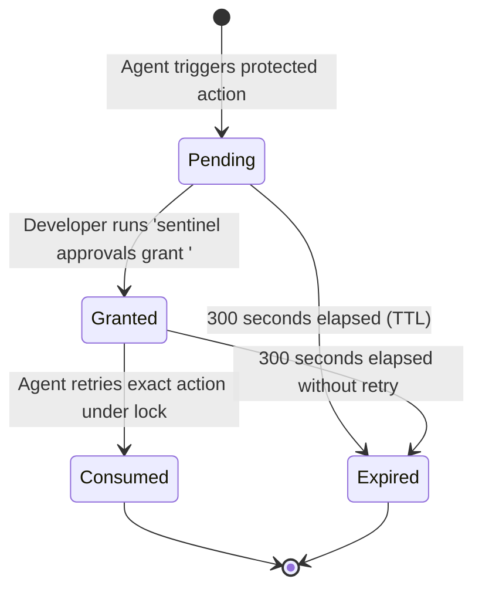

# Sentinel AI Agent Firewall Guide

Sentinel functions as a pre-action policy firewall between autonomous AI coding agents and your local environment. It intercepts tool execution requests—such as file edits, shell execution, and network calls—and deterministically evaluates them against security policies before any bytes are written or commands executed.

---

## 1. Supported Provider Integrations

| Feature | Anthropic Claude Code | OpenAI Codex | GitHub Copilot CLI |
| :--- | :---: | :---: | :---: |
| **Integration Status** | **Production Native** | **Preview / Best-Effort** | **Preview / Best-Effort** |
| **Enforcement Protocol** | Native `PreToolUse` Hook | Wrapped CLI Interceptor | Wrapped CLI Interceptor |
| **Hook Failure Mode** | **Fail-Closed** (`onFailure: block`) | Fail-Open Upstream | Fail-Open Upstream |
| **Degraded Flag Req.** | None (Native Security) | **`--allow-degraded-hooks`** | **`--allow-degraded-hooks`** |
| **Restricted Execution** | Native `--restricted` flag | Filtered Process Launch | Filtered Process Launch |
| **Self-Protection** | Enforced | Enforced | Enforced |
| **Single-Use Approvals**| Cryptographic Token Binding | Cryptographic Token Binding | Cryptographic Token Binding |

---

## 2. Anthropic Claude Code (Fail-Closed Native)

Claude Code features a native hook architecture that allows Sentinel to execute as an authoritative, fail-closed policy gate.

### Setup and Configuration
Run setup to configure Sentinel's exec-form hook into `.claude/settings.json`:

```sh
sentinel agent setup claude
```

This performs the following actions:
1. Atomically backs up existing `.claude/settings.json`.
2. Registers Sentinel's `PreToolUse` hook with `onFailure: "block"` and a 10-second timeout.
3. Records binary and configuration SHA-256 hashes for integrity verification.
4. Initializes the audit hash chain in `.sentinel/audit-chain-v2.jsonl`.

### Launching Guarded Sessions
Launch Claude Code under Sentinel supervision:

```sh
sentinel guard --scope 'src/**' -- claude
```

### Security Guarantees:
- **Restricted Launch**: Sentinel passes `--restricted` to Claude Code, disabling unapproved MCP servers, dangerous system commands, and arbitrary skill loading.
- **Fail-Closed Gate**: If Sentinel crashes, encounters an internal error, or times out (>10s), Claude Code blocks the proposed action automatically.
- **Scope Enforcement**: File modifications outside the specified `--scope` (e.g., `src/**`) are rejected.
- **Session Isolation**: Each guarded session receives an ephemeral 8-hour cryptographic nonce; only one active guarded session is permitted per project at a time.

---

## 3. OpenAI Codex & GitHub Copilot CLI (Preview & Degraded Hooks)

### The Upstream Limitation
Unlike Claude Code, OpenAI Codex and GitHub Copilot CLI runners do not currently provide a native, synchronous, fail-closed `PreToolUse` hook interface. In standard operation, their execution pipelines fail open if an external process fails or times out.

### The Degraded Hook Model
Sentinel provides preview support for Codex and Copilot through an interceptor bridge, but explicitly requires the `--allow-degraded-hooks` flag to acknowledge the risk:

```sh
# Setup provider bridge
sentinel agent setup codex
# or: sentinel agent setup copilot

# Check provider status
sentinel agent status --provider codex

# Guard session (Requires explicit degradation acknowledgment)
sentinel guard --provider codex --allow-degraded-hooks -- codex
```

> [!CAUTION]
> If you run `sentinel guard --provider codex` or `copilot` without `--allow-degraded-hooks`, Sentinel will terminate immediately with **Exit Code 2**. This prevents accidental reliance on best-effort hooks in strict security environments.

---

## 4. Pre-Action Evaluation Semantics

When an agent requests an action, Sentinel intercepts the payload and inspects:
1. **Target Paths**: Normalized relative paths are matched against `policy.protected_paths` and custom rules.
2. **Action Type**:
   - `file.read`: Permitted, but `.env` and internal Sentinel security state (`.sentinel/**`) are denied.
   - `file.write`: Evaluated against security level floors (L0: log, L1/L2: approval, L3: deny). Writes to `sentinel.yml`, `.git`, `.claude`, or `.sentinel` are **always denied**.
   - `shell.execute`: Denied at L2 and L3; restricted in Claude Code.
   - `network.access`: Denied at L2 and L3.
3. **Additive Risk Score**: Calculated from target sensitivity, destructive indicators, CVE reachability, and KEV status (0 to 10).

---

## 5. The Approval Lifecycle

When an action requires approval ($D = \text{RequireApproval}$), Sentinel emits a pending approval request.



### Key Approval Properties:
- **Exact Action Binding**: A grant is bound to the exact tool name, arguments SHA-256, target file content hash, project root hash, session nonce, and active policy hash.
- **Single-Use Consumption**: Once verified during an agent retry, the token is consumed atomically under an exclusive file lock (`flock`). It cannot be reused.
- **5-Minute TTL**: Pending and granted tokens expire automatically after 300 seconds.
- **Zero Plaintext Payloads**: Sentinel never stores raw tool payloads or file contents in `.sentinel/agent/approvals.json`.

---

## 6. Security Boundaries & Limitations

1. **Pre-Action Policy Gate, Not an OS Sandbox**:
   Sentinel evaluates actions before execution based on provider hooks. It does not isolate processes at the kernel level (e.g., via Linux cgroups, namespaces, seccomp, or macOS sandbox-exec).
2. **Local Operator Trust**:
   Sentinel protects the repository against untrusted agent tool calls. An operator with local terminal access who bypasses `sentinel guard` or runs arbitrary shell commands directly operates outside Sentinel's boundary.
3. **No LLM Self-Authorization**:
   An AI agent cannot authorize its own operations. Only a human operator running `sentinel approvals grant` from a separate terminal can clear protected actions.

