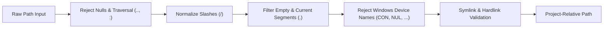

# Sentinel Algorithmic & Cryptographic Specifications

Sentinel relies on provably deterministic algorithms, mathematical scoring models, and cryptographic primitives rather than heuristic or probabilistic LLM evaluations. This document details the mathematical formulations, state machines, and cryptographic algorithms implemented across the Sentinel workspace.

---

## 1. Deterministic Policy Precedence & Level Floors

Policy evaluation in `sentinel-policy` maps an incoming action context $(A, \mathcal{P})$—where $A \in \{\text{FileRead}, \text{FileWrite}, \text{ShellExecute}, \text{NetworkAccess}\}$ and $\mathcal{P} = \{p_1, p_2, \dots, p_k\}$ is a set of normalized relative file paths—to a deterministic security decision:

$$D \in \{\text{Allow}, \text{LogOnly}, \text{RequireApproval}, \text{Deny}\}$$

### Total Decision Ordering (Rank)

Decisions possess a strict total ordering:

$$\text{Allow}\ (0) \prec \text{LogOnly}\ (1) \prec \text{RequireApproval}\ (2) \prec \text{Deny}\ (3)$$

### Rule Precedence Resolution

Given a policy with $M$ configured rules $R = \{r_1, r_2, \dots, r_m\}$ and default action $D_{\text{default}}$:

1. Identify matched rules:
   $$\mathcal{M} = \{r \in R \mid r.\text{action} = A \land (r.\text{paths} = \emptyset \lor \exists p \in \mathcal{P}, \exists g \in r.\text{paths} : p \text{ matches } g)\}$$
2. The initial rule decision $D_{\text{rules}}$ is the maximum ranked decision among matches:
   $$D_{\text{rules}} = \begin{cases} \max_{r \in \mathcal{M}} \text{rank}(r.\text{decision}) & \text{if } \mathcal{M} \neq \emptyset \\ D_{\text{default}} & \text{if } \mathcal{M} = \emptyset \end{cases}$$

### Security Level Floors ($D_{\text{floor}}$)

Each project defines a security level $L \in \{L0, L1, L2, L3\}$. Let $\mathbb{I}_{\text{protected}} = 1$ if any target path $p \in \mathcal{P}$ matches a glob in `policy.protected_paths`:

$$D_{\text{floor}}(L, A, \mathbb{I}_{\text{protected}}) = \begin{cases}
\text{Deny} & \text{if } L = L3 \land A = \text{FileWrite} \\
\text{Deny} & \text{if } L \in \{L2, L3\} \land A \in \{\text{ShellExecute}, \text{NetworkAccess}\} \\
\text{RequireApproval} & \text{if } L \in \{L1, L2\} \land A = \text{FileWrite} \land \mathbb{I}_{\text{protected}} = 1 \\
\text{LogOnly} & \text{if } L = L0 \land A = \text{FileWrite} \land \mathbb{I}_{\text{protected}} = 1 \\
\text{Allow} & \text{otherwise}
\end{cases}$$

### Final Deterministic Precedence
The final decision $D_{\text{final}}$ is the least restrictive decision that satisfies both rule evaluation and the level floor:

$$D_{\text{final}} = \max\Big(D_{\text{rules}}, \; D_{\text{floor}}\Big)$$

**Invariant**: A higher security level floor can never be downgraded by an explicit custom rule or default action. $\text{Deny}$ always overrides $\text{RequireApproval}$, which overrides $\text{LogOnly}$, which overrides $\text{Allow}$.

---

## 2. Additive Risk Scoring Model

Sentinel evaluates risk using an additive, bounded evidence vector $\mathbf{e} \in \{0, 1\}^7$ in `sentinel-policy`. The risk score produces an integer in $[0, 10]$ that quantifies the operational severity of an action or vulnerability.

### Evidence Vector Definition

$$\mathbf{e} = \big(e_{\text{protected}}, \; e_{\text{destructive}}, \; e_{\text{secret}}, \; e_{\text{reachable}}, \; e_{\text{kev}}, \; e_{\text{epss}}, \; e_{\text{uncertain}}\big)$$

Where:
- $e_{\text{protected}} \in \{0, 1\}$: Target path touches a declared protected asset (e.g., auth, billing, workflows).
- $e_{\text{destructive}} \in \{0, 1\}$: Operation overwrites, truncates, deletes, or executes shell commands.
- $e_{\text{secret}} \in \{0, 1\}$: Target path or payload touches credential stores, `.env`, or exposed tokens.
- $e_{\text{reachable}} \in \{0, 1\}$: Static dependency analysis proved active import path from entrypoint.
- $e_{\text{kev}} \in \{0, 1\}$: Associated CVE is cataloged in CISA Known Exploited Vulnerabilities.
- $e_{\text{epss}} \in \{0, 1\}$: Exploit Prediction Scoring System probability $\ge 0.10$ (90th percentile).
- $e_{\text{uncertain}} \in \{0, 1\}$: Analysis scope incomplete, complex AST syntax, or unanalyzed ecosystem.

### Scoring Formula

$$\text{RiskScore}(\mathbf{e}) = \min\Big(10, \; 3 e_{\text{protected}} + 4 e_{\text{destructive}} + 4 e_{\text{secret}} + 2 e_{\text{reachable}} + 3 e_{\text{kev}} + 2 e_{\text{epss}} + 1 e_{\text{uncertain}}\Big)$$

### Mathematical Properties:
1. **Bounded Range**: $\text{RiskScore}(\mathbf{e}) \in [0, 10]$ for all valid inputs.
2. **Monotonicity**: For all evidence vectors $\mathbf{e}_1 \le \mathbf{e}_2$ (element-wise), $\text{RiskScore}(\mathbf{e}_1) \le \text{RiskScore}(\mathbf{e}_2)$.
3. **Decoupled Authorization**: A high risk score strengthens logging or prompts approvals, but **never authorizes an operation**. An explicit $\text{Deny}$ decision stands regardless of whether the risk score is 0 or 10.

---

## 3. Domain-Separated Cryptographic Hash Chaining

To ensure tamper-evidence across local audit logs without requiring a heavy centralized database, `sentinel-audit` implements an incremental, append-only cryptographic hash chain.

### Canonical JSON Serialization Algorithm
Standard JSON allows arbitrary key ordering and whitespace, which produces non-deterministic byte hashes. Sentinel implements a deterministic recursive sorting algorithm:

$$\text{Canonical}(V) = \begin{cases}
\text{BTreeMap}\langle k_i, \text{Canonical}(v_i)\rangle & \text{if } V = \text{Object}(\{(k_i, v_i)\}) \\
[\text{Canonical}(a_1), \dots, \text{Canonical}(a_n)] & \text{if } V = \text{Array}([a_1, \dots, a_n]) \\
V & \text{if } V \in \{\text{String}, \text{Number}, \text{Bool}, \text{Null}\}
\end{cases}$$

The sorted value is serialized to UTF-8 bytes using `serde_json::to_vec` with zero extra whitespace.

### Hash Chaining Formulation
For event sequence $i \in \{1, 2, \dots, N\}$:

- **Genesis Seed**:
  $$H_0 = 0^{64} = \text{"0000000000000000000000000000000000000000000000000000000000000000"}$$

- **Chain Link Hash**:
  $$H_i = \text{SHA-256}\Big(\text{"sentinel-audit-v2\n"} \parallel \text{str}(i) \parallel \text{"\n"} \parallel H_{i-1} \parallel \text{"\n"} \parallel \text{Canonical}(E_i) \parallel \mathcal{A}_i\Big)$$

Where:
- $\text{"sentinel-audit-v2\n"}$ is the constant domain-separation string preventing cross-protocol collisions.
- $\text{str}(i)$ is the decimal string representation of sequence number $i$.
- $H_{i-1}$ is the lowercase hexadecimal SHA-256 digest of the previous link.
- $\text{Canonical}(E_i)$ is the canonical UTF-8 JSON bytes of audit event $i$.
- $\mathcal{A}_i$ is the optional attached decision journal digest:
  $$\mathcal{A}_i = \begin{cases} \text{"\nattachment-sha256\n"} \parallel h_{\text{journal}} \parallel \text{"\n"} & \text{if attached} \\ \emptyset & \text{otherwise} \end{cases}$$

### Truncation and Fork Detection
A hash chain alone cannot prevent an attacker with local file access from truncating the log to an earlier valid state. Sentinel resolves this via **External Checkpoints**:

$$\text{Checkpoint} = \big(\text{project}, \; \text{records}: k, \; \text{head}: H_k\big)$$

Verification against checkpoint $(\hat{k}, \hat{H})$ requires:
1. Current log length $N \ge \hat{k}$ (truncation check).
2. The hash at sequence $\hat{k}$ must strictly equal $\hat{H}$:
   $$H_{\hat{k}} = \hat{H}$$
If $N < \hat{k}$ or $H_{\hat{k}} \neq \hat{H}$, verification immediately fails with **Exit Code 8**.

---

## 4. Static Import Reachability Graph Analysis

The `sentinel-scanner` static analysis module models Python dependency usage as a directed reachability graph over module import declarations.

### 3-State Reachability Lattice
Reachability is modeled as a 3-state semilattice:

```
         unknown (?)
        /           \
reachable (T)    not_analyzed (⊥)
```

- $\text{reachable}$: An explicit, verified static import path connects an analyzed entrypoint to the target distribution's module namespace.
- $\text{unknown}$: An entrypoint imports packages dynamically, multiline docstring syntax is detected, entrypoint count exceeds limits, or dependency ecosystem is non-Python.
- $\text{not-analyzed}$: No entrypoint was supplied, or finding is a secret with no package identity.

**Soundness Invariant**: Sentinel **never emits `not_reachable`** merely from the absence of static imports. Dynamic `__import__`, `importlib.import_module`, reflection, or conditional branching could invoke dependencies at runtime. Assuming negative reachability would introduce dangerous false negatives.

### Graph Traversal Constraints
To guarantee sub-second execution and prevent DoS attacks:
- Entrypoints: Bounded to $1 \le |\mathcal{E}| \le 32$.
- Module Nodes: Graph expansion halts if $|\mathcal{V}_{\text{seen}}| \ge 256$.
- File Read Ceiling: Each Python module read is bounded to $1\text{ MiB}$.
- Symlink Policy: File symlinks in Python paths are strictly rejected.

---

## 5. Single-Use Cryptographic Approval Token Binding

When an agent operation requires elevated authorization ($D_{\text{final}} = \text{RequireApproval}$), `sentinel-agent` issues an ephemeral, tightly-bound approval request.

### Cryptographic Action Binding Digest
The binding token $\mathcal{B}$ cryptographically seals all contextual parameters:

$$\mathcal{B} = \text{SHA-256}\Big(\text{Canonical}\big(\mathcal{J}_{\text{binding}}\big)\Big)$$

Where $\mathcal{J}_{\text{binding}}$ is the structured object:

```json
{
  "action": {
    "agent": "<agent_id>",
    "session": "<session_id>",
    "operation": "<FileWrite|ShellExecute>",
    "targets": ["<normalized_target_path>"],
    "arguments_hash": "<sha256_of_tool_arguments>",
    "target_state_hashes": ["<sha256_of_current_target_bytes>"],
    "scope": "<task_scope_glob>"
  },
  "project": "<sha256_of_canonical_project_root>",
  "nonce": "<sha256_of_session_nonce>",
  "policy": "<sha256_of_active_policy_yaml>",
  "risk_evidence": { ... },
  "config": "<sha256_of_config_path>"
}
```

### Consumption and Lifecycle Invariants
1. **5-Minute TTL**: Approvals expire exactly 300 seconds after creation:
   $$\text{Valid}(\tau) \iff t_{\text{current}} - t_{\text{created}} \le 300\text{ seconds}$$
2. **Single-Use Consumption**: Once granted, a token can be redeemed exactly once. Upon consumption, the token is marked `consumed: true` under an exclusive advisory file lock (`fs2::FileExt::lock_exclusive`).
3. **No Parameter Substitution**: If the agent alters a single byte of proposed tool arguments, target file contents change, or session nonces diverge, $\mathcal{B}_{\text{retry}} \neq \mathcal{B}_{\text{granted}}$, and execution is denied.
4. **State Bounds**: The approval storage file `.sentinel/agent/approvals.json` is strictly bounded to 1,000 requests and 4 MiB.

---

## 6. Path Normalization & Security Traversal Defense

File paths supplied by AI agents, tool calls, or configuration files are untrusted inputs subject to lexical traversal attacks, alternate data streams, and Unicode deception.

### Canonical Path Normalization Pipeline



### Security Checks Enforced:
1. **No Lexical Parent References**: Any segment matching `..`, containing `\`, `:`, or `\0` is rejected immediately.
2. **Absolute Path Rejection**: Leading `/` or Windows drive prefixes (`C:`) are prohibited for project-scoped actions.
3. **Windows Reserved Device Names**: On all platforms, path components matching the following reserved namespaces (case-insensitive) are rejected:
   $$\text{Reserved} = \{\text{CON}, \text{PRN}, \text{AUX}, \text{NUL}\} \cup \{\text{COM1}\dots\text{COM9}\} \cup \{\text{LPT1}\dots\text{LPT9}\}$$
4. **Link Count and Reparse Point Verification**:
   - **Unix**: Files must satisfy $\text{nlink}() = 1$. Hard links are rejected to prevent multi-path aliasing.
   - **Windows**: Files with attribute bit `0x400` (`FILE_ATTRIBUTE_REPARSE_POINT`) are rejected to prevent NTFS junctions and directory symlink redirection.
