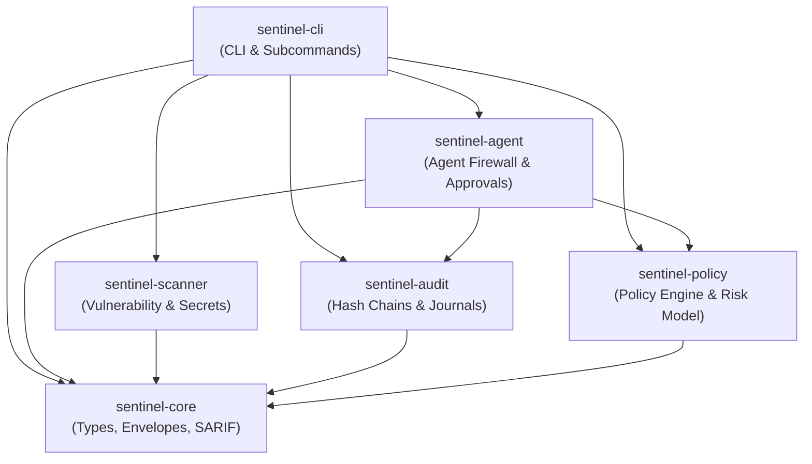
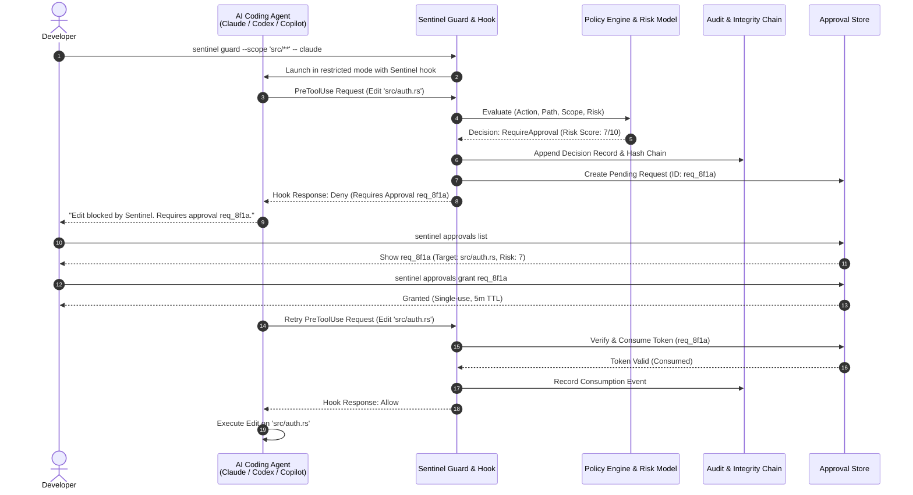

# Sentinel System Architecture

Sentinel is a local-first, pre-action security policy gate, vulnerability scanner, and cryptographic audit engine designed to secure AI coding agents and development workflows. It bridges the trust gap between autonomous AI agents (such as Anthropic Claude Code, OpenAI Codex, and GitHub Copilot) and sensitive local development environments.

---

## 1. Architectural Philosophy and Design Principles

Sentinel operates under five core design tenets:

1. **Pre-Action Policy Interception (Gate, Not Sandbox)**:
   Sentinel evaluates actions *before* execution occurs. It intercepts tool requests (file writes, shell commands, network access) and deterministically decides whether the operation is allowed, denied, or requires explicit human approval. Sentinel is a pre-action policy gate, not an operating-system sandbox; it relies on provider hook protocols and restricted execution modes.
2. **Local-First & Offline Resilience**:
   Sentinel does not require a cloud connection, proprietary telemetry, or hosted dashboard. Dependency intelligence is cached locally in `.sentinel/cache/`, policies are stored in the repo (`sentinel.yml`), and audit logs reside in `.sentinel/audit.jsonl`. Scans can run completely offline (`--offline`).
3. **Deterministic Evaluation (No LLM in the Policy Loop)**:
   Security decisions are computed using deterministic algorithms, strict precedence rules, and mathematical risk scoring. Sentinel never uses an LLM to judge an LLM; policy decisions cannot be subverted by prompt injection or conversational trickery.
4. **Cryptographic Tamper-Evidence**:
   Audit logs and pre-action decisions are bound into domain-separated SHA-256 hash chains with canonical JSON serialization. Independent external checkpoints detect retroactive log tampering or truncation attacks.
5. **Zero Secret Leakage**:
   All scanning, logging, and error output enforces strict redaction of credentials, API keys, and sensitive tokens. Raw tool arguments, file payloads, and prompts are never stored in plain text.

---

## 2. Workspace Crate Architecture

Sentinel is structured as a high-performance, modular Rust workspace:

```bash
crates/
├── sentinel-core/      # Domain primitives, schema versions, result envelopes, SARIF models
├── sentinel-policy/    # Policy parsing, L0-L3 levels, glob matching, additive risk scoring
├── sentinel-scanner/   # Lockfile parsers (Cargo, npm, uv, Poetry), OSV API, EPSS/KEV, secrets
├── sentinel-audit/     # JSONL audit store, domain-separated SHA-256 hash chains, checkpoints
├── sentinel-agent/     # Pre-action hooks, Claude Code gate, Codex/Copilot adapters, approvals
└── sentinel-cli/       # CLI commands, Clap parser, JSON/SARIF output, exit code routing
```

### Crate Dependency Graph



---

## 3. Crate Responsibilities & Boundaries

### `sentinel-core`

- **Purpose**: Defines shared foundational types, protocol envelopes, and serialization formats.
- **Components**:
  - `ResultEnvelope<T>` and `ErrorEnvelope`: Standardized JSON envelopes across schema versions 1 and 2.
  - `Finding`: Typed vulnerability, secret, or policy finding with severity levels (`critical`, `high`, `medium`, `low`, `info`).
  - `SarifReport`: OASIS SARIF v2.1.0 log serializer for seamless integration into GitHub Advanced Security and GitLab SAST.
  - `PathNormalizer`: Cross-platform path validation, lexical traversal elimination, and device-name blocking.

### `sentinel-policy`

- **Purpose**: Implements deterministic policy evaluation, security levels, and additive risk scoring.
- **Components**:
  - `Policy`: Deserializer for `sentinel.yml` schema v1 (security levels, protected paths, custom rules).
  - `EvaluationEngine`: Computes deterministic decision: $\text{Deny} \succ \text{RequireApproval} \succ \text{LogOnly} \succ \text{Allow}$.
  - `RiskScoringModel`: Bounded additive risk formula evaluating target sensitivity, destructive operations, known CVEs, KEV status, EPSS percentiles, and static reachability.
  - `RuleMatcher`: Glob-pattern matcher against project-relative paths, preventing escape from workspace roots.

### `sentinel-scanner`

- **Purpose**: Discovers security flaws in code, dependencies, and project artifacts.
- **Components**:
  - `DependencyParser`: Native lockfile parsers for `Cargo.lock`, `package-lock.json` (v2 and v3), `uv.lock`, `poetry.lock`, pinned `requirements.txt`, and CycloneDX 1.4/1.5 JSON SBOMs.
  - `OsvClient`: Offline-first client for Google OSV API with local disk caching (`.sentinel/cache/`) and retry policies.
  - `EnrichmentEngine`: Ingests and caches CISA KEV (Known Exploited Vulnerabilities) and EPSS (Exploit Prediction Scoring System) metrics.
  - `ReachabilityAnalyzer`: Static AST/lexical import graph analyzer for Python projects determining if vulnerable packages are referenced in active code paths.
  - `SecretsScanner`: High-throughput scanner detecting high-entropy secrets, private keys, AWS tokens, GitHub PATs, and credentials with regex heuristics and redaction.

### `sentinel-audit`

- **Purpose**: Maintains tamper-evident audit logs and decision records.
- **Components**:
  - `AuditLogger`: Appends structured JSONL events to `.sentinel/audit.jsonl` under cooperative file locks.
  - `IntegrityChain`: Implements domain-separated SHA-256 hash chaining over canonical JSON records (`audit-chain-v2.jsonl`).
  - `DecisionJournal`: Stores detailed pre-action decisions in `.sentinel/decisions/` and binds heads via `attachment-sha256`.
  - `CheckpointEngine`: Creates non-overwriting external checkpoint snapshots and verifies chain continuity (`sentinel audit verify`).

### `sentinel-agent`

- **Purpose**: Provides pre-action interception, runtime guarding, and approval workflows for AI agents.
- **Components**:
  - `ClaudeHookHandler`: Fail-closed PreToolUse hook server communicating with Anthropic Claude Code via standard JSON protocols.
  - `ProviderAdapter`: Multi-provider abstraction managing Claude Code (`fail-closed`), OpenAI Codex (`preview/degraded`), and GitHub Copilot CLI (`preview/degraded`).
  - `ApprovalEngine`: Generates cryptographic approval tokens, enforces single-use consumption, verifies 5-minute TTL, and binds requests to file hashes and session nonces.
  - `GuardSession`: Orchestrates agent process lifecycles, injects strict `--restricted` configurations, and strips unapproved MCP tools.

### `sentinel-cli`

- **Purpose**: Command-line interface and user entrypoint.
- **Components**:
  - `CliParser`: Clap-based declarative argument parser supporting global flags (`--project`, `--config`, `--format`, `--quiet`, `--verbose`, `--no-color`).
  - `CommandRouter`: Maps subcommands (`init`, `policy`, `scan`, `audit`, `doctor`, `agent`, `guard`, `approvals`, `redteam`) to crate services.
  - `ExitHandler`: Maps errors to well-defined exit codes (0 to 8).

---

## 4. End-to-End Data Flow

The following sequence diagram illustrates an AI agent attempting a protected file edit under Sentinel's pre-action gate:



---

## 5. Security Enclaves & Boundaries

| Component | In-Scope Protection | Out-of-Scope / Boundary Limit |
| :--- | :--- | :--- |
| **Agent Hook Gate** | Pre-action interception of supported tools (File Write, Read, Shell). | Process already running with user privileges; direct OS syscalls bypassing agent client. |
| **Policy Engine** | Deterministic rule matching, path normalization, scope restrictions. | Natural language intent inside prompt; semantic code correctness. |
| **Vulnerability Scanner** | Known CVEs in supported lockfiles, OSV database, static reachability. | Zero-day vulnerabilities not in OSV; unpinned dependencies; dynamic reflection. |
| **Secrets Scanner** | High-entropy credentials, private keys, standard API tokens in text files. | Steganography, encrypted payloads, files exceeding 1 MiB. |
| **Audit Log** | Tamper detection, hash chain continuity, truncation detection via checkpoints. | Same-user filesystem access overwriting logs *and* external checkpoints simultaneously. |

Sentinel operates as the **governance and authorization layer** for AI agents. When combined with OS-level virtualization (containers, VMs) and version control (Git), it provides defense-in-depth against autonomous agent manipulation and supply chain risks.
