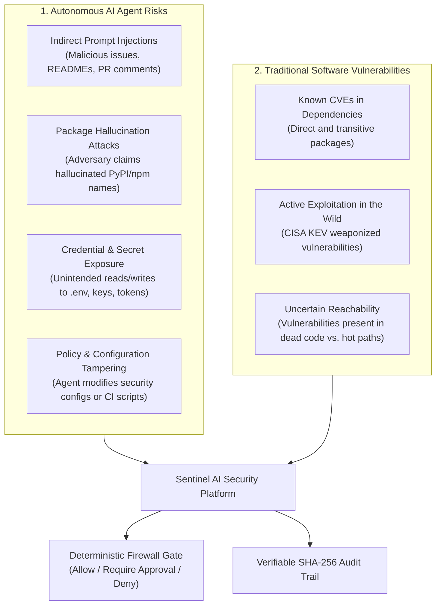

# Sentinel Security Threat Model

## 1. Problem Statement: The AI Coding Assistant Trust Gap

The software development lifecycle has undergone a fundamental transformation from passive code autocomplete to **autonomous AI coding agents** (e.g., Anthropic Claude Code, OpenAI Codex, GitHub Copilot CLI). Developers increasingly grant these agents broad permissions to:
1. Create, edit, and delete arbitrary repository files.
2. Execute shell commands, test runners, and package managers.
3. Install third-party packages from public registries.
4. Interact with external network endpoints and APIs.

This introduces a critical security challenge: **How can developers trust autonomous AI-generated actions before they impact the codebase and runtime environments?**

### The Dual Threat Landscape

Modern AI-assisted development introduces two intertwined categories of risk:

---

## 2. Threat Classification & Mitigations

| Threat | Attack Scenario | Sentinel Mitigation | Milestone |
|---|---|---|---|
| **Unauthorized File Writes** | Agent modifies production credentials, auth logic (`src/auth/**`), payment code, or Sentinel configuration (`sentinel.yml`). | **Deterministic Policy Engine & Pre-Action Hook**: Protected paths require human approval or are denied outright; self-protection rules unconditionally block writes to Sentinel configs, binary, and git state. | v0.0.1 / v0.0.2 |
| **Exposed Credentials & Secrets** | Developer accidentally commits API keys; agent reads `.env` and exposes secrets in prompts or tool calls. | **Pattern-Based Secrets Scanner & Strict Output Redaction**: Scans repository text files up to 1 MiB; redacts secret values across stdout, stderr, JSON, SARIF, and audit logs. | v0.0.1 |
| **Vulnerable Dependencies** | Agent adds or updates a package containing known security vulnerabilities. | **OSV Dependency Scanner with Offline Caching**: Scans `Cargo.lock`, `package-lock.json`, `uv.lock`, `poetry.lock`, and pinned `requirements.txt` against OSV advisories. | v0.0.1 / v0.0.2 |
| **Weaponized Exploit Acceleration** | Vulnerability is actively exploited in the wild or has a high probability of weaponization. | **EPSS & CISA KEV Intelligence Enrichment**: Enriches findings with FIRST EPSS probability and CISA KEV active exploitation catalog, raising deterministic risk scores. | v0.0.2 |
| **Package Hallucinations** | Agent invents a package name; attacker registers it on public PyPI/npm with malicious payload. | **Explicit Registry Source Diagnostics**: Flags unverified sources, private registries, and direct Git dependencies; requires exact resolved version pins. | v0.0.2 |
| **Shell Command Injections** | Agent attempts arbitrary shell execution (`rm -rf`, curl pipes, reverse shells). | **Shell Denial & Task Scoping**: `ActionType::ShellExecute` is denied in guarded sessions under L2/L3 security levels; shell actions cannot bypass file protection rules. | v0.0.2 |
| **Approval Replay / Tampering** | Agent modifies tool arguments after approval is granted to sneak in unauthorized edits. | **Single-Use Cryptographic Approval Binding**: Approval tokens are bound to exact argument hashes, target file hashes, policy versions, and session nonces; consumed atomically once under file lock with 5-minute TTL. | v0.0.2 |
| **Audit Log Tampering** | Attacker or rogue process modifies local audit records to erase traces of unauthorized activity. | **SHA-256 Canonical Hash-Chained Sidecars & Checkpoints**: Detects internal modifications, link breaks, and truncation via independently retained outside-project checkpoints. | v0.0.2 |
| **Policy Downgrade in PRs** | Malicious pull request weakens `sentinel.yml` to bypass security checks on merge. | **Base-Commit Policy PR Gate**: `sentinel policy test --changed-files` evaluates proposed PR writes against the protected base commit's policy, rejecting downgrades. | v0.0.2 |

---

## 3. Security Invariants

Sentinel enforces several non-negotiable security invariants across all subsystems:

1. **Deterministic Precedence**:
   $$\text{Deny} \succ \text{RequireApproval} \succ \text{LogOnly} \succ \text{Allow}$$
   An explicit `deny` can never be overridden by approval or allow. Risk scores and project criticality levels may only strengthen restrictions, never weaken them.
2. **AI Cannot Override Policy**:
   Security decisions are computed deterministically in Rust. No LLM response, prompt instruction, or agent confidence score can authorize an action.
3. **Fail-Closed on Uncertainty**:
   Malformed callback payloads, missing session nonces, broken audit chains, or expired approval tokens result in an immediate fail-closed denial.
4. **Zero Raw Secret / Prompt Leakage**:
   Sentinel never stores or prints raw secret values, full user prompts, or plaintext diff contents in audit logs, stdout/stderr, or diagnostic envelopes.
5. **Single-Use Expiring Approvals**:
   Approval tokens expire after 5 minutes and are consumed once under a cooperative file lock. Retries with changed tool arguments or file states require a fresh grant.

---

## 4. Protected Assets

Sentinel treats the following repository resources as protected assets:
- **Application Source Code**: Especially designated security-sensitive subsystems (e.g., authentication, payments, data access layers).
- **Project Configuration & Security Policies**: `sentinel.yml`, GitHub Actions workflows (`.github/workflows/**`), and provider hook settings (`.claude/settings.json`, `.codex/hooks.json`, `.github/hooks/sentinel.json`).
- **Secrets & Credentials**: `.env` files, private keys (`BEGIN PRIVATE KEY`), cloud tokens (AWS, GitHub PATs, Slack tokens).
- **Audit Trails**: `.sentinel/audit.jsonl`, `.sentinel/audit-chain-v2.jsonl`, and `.sentinel/agent/decisions.jsonl`.
- **Dependency Manifests & Lockfiles**: `Cargo.lock`, `package-lock.json`, `uv.lock`, `poetry.lock`.

---

## 5. Trust Assumptions & Operational Boundaries

> [!WARNING]
> **Pre-Action Firewall vs. Operating-System Sandbox**:
> Sentinel is a pre-action hook firewall that evaluates and gates proposed agent actions *before* execution. **It is not an operating-system sandbox or container.**

### What Sentinel Guarantees
- Intercepts and validates tool requests delivered through supported pre-action hooks (Claude Code, OpenAI Codex, GitHub Copilot).
- Evaluates actions deterministically against declared policies and risk signals.
- Denies known path traversal attempts (`..`), symlinks, hardlinks, Windows reserved devices, and bidi control characters.
- Detects audit record tampering and log truncation when verified against an external checkpoint.

### What Lies Outside Sentinel's Boundary
- **Same-User Process Access**: A malicious process running with the same local user privileges can directly manipulate filesystem entries outside Sentinel's hooks.
- **Upstream Fail-Open Behavior in Best-Effort Providers**: While Claude Code enforces fail-closed blocking (`onFailure: "block"`), Codex and Copilot CLI runners may continue tool execution if a hook times out or crashes. Sentinel requires `--allow-degraded-hooks` to explicitly acknowledge this operational reality.
- **Already-Running Processes & Unsupervised Shell Sessions**: Commands executed by developers directly in external terminal sessions are not intercepted by agent hooks.
- **Compromised Host / Administrator Access**: If the host workstation or administrator account is compromised, external OS-level sandboxing (e.g., Docker, Bubblewrap, VMs) is required for containment.

