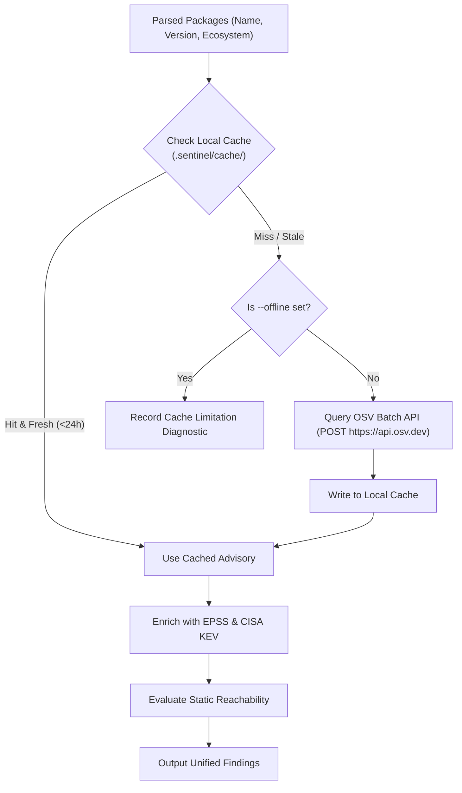

# Sentinel Vulnerability and Secrets Scanning Reference

Sentinel provides a dual-engine security scanner designed for fast, local-first detection of known vulnerable dependencies (CVEs) and exposed credentials in developer repositories.

---

## 1. Supported Ecosystems & Inputs

Sentinel natively discovers and parses dependency lockfiles without requiring external language package managers (e.g., without running `cargo`, `npm`, or `pip`):

| Ecosystem | Supported Files | Detection Mechanism |
| :--- | :--- | :--- |
| **Rust / Cargo** | `Cargo.lock` | Native TOML parser (exact package name & version) |
| **JavaScript / Node.js** | `package-lock.json` (v2 & v3) | Native JSON parser (direct and transitive dependencies) |
| **Python / uv** | `uv.lock` | Native TOML parser with workspace ownership reconciliation |
| **Python / Poetry** | `poetry.lock` | Native TOML parser |
| **Python / pip** | `requirements.txt` | Pinned constraints parser (`==` syntax) |
| **Software Bill of Materials** | CycloneDX 1.4 & 1.5 JSON | `sentinel scan --sbom <path>` (cross-ecosystem components) |

---

## 2. Vulnerability Intelligence & OSV Integration

Sentinel queries Google OSV (Open Source Vulnerabilities) to retrieve known security advisories across all discovered packages.



### Offline Caching

- Advisories are cached on disk under `.sentinel/cache/` using SHA-256 keys.
- Cache entries include timestamps to track data freshness.
- With `--offline`, Sentinel never touches the network. If intelligence is missing or stale, Sentinel continues scanning and records explicit coverage limitations, returning **Exit Code 7** if coverage was incomplete.

---

## 3. Exploit Intelligence (EPSS & CISA KEV)

Raw CVE severity (CVSS) often fails to predict actual exploitation in the wild. Sentinel enriches dependency findings with real-world threat metrics:

1. **CISA Known Exploited Vulnerabilities (KEV)**:
   - Identifies vulnerabilities known to be actively weaponized by threat actors.
   - When a CVE matches the KEV catalog, Sentinel raises the additive risk score by **+3**.
2. **Exploit Prediction Scoring System (EPSS)**:
   - Ingests EPSS probability percentiles.
   - Findings with EPSS probability $\ge 0.10$ (90th percentile) increase the risk score by **+2**.

---

## 4. Static Python Import Reachability

To reduce alert fatigue and distinguish between unused dependencies and active attack vectors, Sentinel includes a conservative static import analyzer for Python projects.

### Invocation:

```sh
sentinel scan --reachability --entrypoint src/main.py --entrypoint src/api.py
```

### Reachability Statuses:

- **`reachable`**: An explicit static import chain exists from a declared entrypoint to the vulnerable package. (Increases risk score by **+2**).
- **`unknown`**: Dynamic imports (`importlib`), reflection, complex multiline docstrings, or syntax beyond the static parser are detected. (Increases risk score by **+1** for uncertainty).
- **`not_analyzed`**: Finding is not a Python dependency, or no entrypoints were supplied.

> [!NOTE]
> Sentinel **never claims `not_reachable`**. Due to the dynamic nature of Python, absence of static import evidence does not guarantee that a dependency cannot be executed at runtime.

---

## 5. High-Throughput Secrets Scanning

Sentinel scans project files for accidentally committed credentials, private keys, and tokens.

### Detection Capabilities

- **Private Key Headers**: PEM, OpenSSH, PGP, and RSA private keys.
- **Cloud & Service Credentials**: AWS access keys (`AKIA...`), GitHub PATs (`ghp_...`), Slack tokens, Stripe keys, generic API tokens.
- **Shannon Entropy Analysis**: Detects high-entropy random strings in assignment statements and configuration files.

### File Traversal Rules & Bounds

- **File Size Limit**: Files larger than 1 MiB (1,048,576 bytes) are skipped to prevent memory exhaustion.
- **Binary Detection**: Binary files and non-UTF-8 files are automatically excluded.
- **Ignored Directories**: `.git`, `.sentinel`, `.claude`, `node_modules`, `target`, `vendor`, and `.venv` are skipped by default.
- **Strict Redaction**: Discovered secrets are redacted in text output, JSON results, stderr diagnostics, and audit logs. Only truncated cryptographic digests or masked snippets (`AKIA************`) are reported.

---

## 6. Output Envelopes & Exit Codes

### CLI Invocations

```sh
# Human-readable text summary
sentinel scan

# Machine-readable JSON
sentinel scan --format json

# OASIS SARIF v2.1.0 (for GitHub Security code scanning)
sentinel scan --format sarif > results.sarif
```

### Failure Thresholds (`--fail-on`)

You can configure the exit code threshold using `--fail-on <low|medium|high|critical>`:

```sh
sentinel scan --fail-on high
```

### Exit Codes:

- **0**: Clean scan; no findings exceeding failure threshold; full coverage.
- **1**: File system, storage, or internal error.
- **2**: Invalid command-line arguments.
- **3**: Missing or invalid configuration.
- **4**: Vulnerability or secret finding meets or exceeds the `--fail-on` threshold.
- **7**: Scan was incomplete (e.g., missing offline intelligence or unparsed files).
