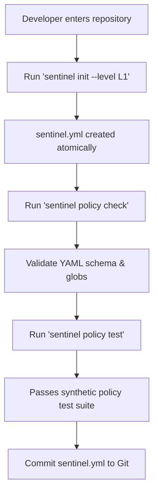
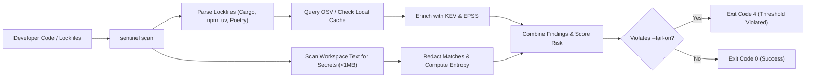
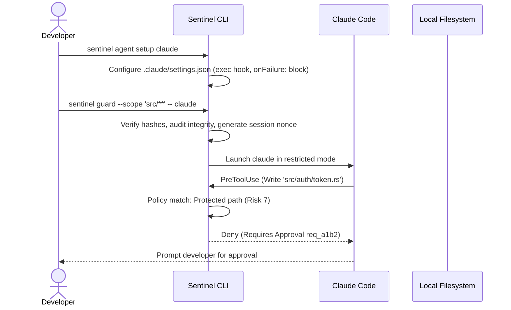
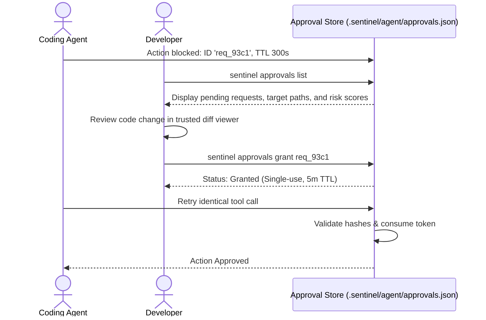
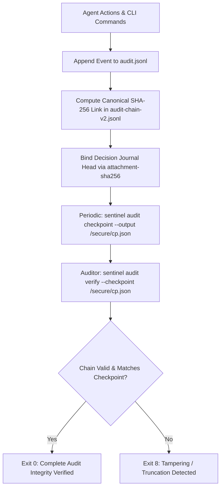

# Sentinel Operational Workflow Plan

This document outlines the standard operational workflows for developers, security engineers, and automated CI/CD pipelines deploying Sentinel across projects.

---

## Workflow 1: Developer Onboarding & Project Initialization

When introducing Sentinel into a repository, the operator selects a security level that reflects the sensitivity of the codebase.



### Steps:
1. **Initialize Configuration**:
   ```sh
   # Default L1 (Protected files require approval)
   sentinel init --level L1
   ```
   This generates `sentinel.yml` atomically with safe defaults:
   - Security level `L1`
   - Default action `allow`
   - Standard protected paths: `src/auth/**`, `src/payments/**`, `.github/workflows/**`, `.env*`, `sentinel.yml`
   - Scanners enabled: dependencies and secrets
   - Audit enabled with secret redaction
2. **Validate Policy**:
   ```sh
   sentinel policy check
   ```
   Ensures YAML syntax, schema version, glob formats, and rule IDs are strictly valid.
3. **Execute Policy Regression Test**:
   ```sh
   sentinel policy test
   ```
   Verifies that baseline policy tests pass before any agent is authorized to interact with the repository.

---

## Workflow 2: Continuous Vulnerability & Secrets Scanning

Developers and CI systems run `sentinel scan` to uncover known vulnerabilities (CVEs) and leaked secrets before committing code.



### Typical Scan Invocations:
```sh
# Full scan (dependencies + secrets)
sentinel scan

# Dependency-only scan with offline cache
sentinel scan --type dependencies --offline

# Ingest external CycloneDX SBOM
sentinel scan --sbom ./bom.json

# Export OASIS SARIF v2.1.0 for GitHub Security tab
sentinel scan --format sarif > results.sarif

# Enforce zero-tolerance failure on medium+ findings
sentinel scan --fail-on medium
```

---

## Workflow 3: Guarded Autonomous Agent Sessions

Sentinel wraps coding agents in a guarded environment, enforcing pre-action policy gates before any destructive action reaches the filesystem or shell.

### A. Claude Code (Strict Fail-Closed Gate)

Claude Code supports native `PreToolUse` hooks and execution in `--restricted` mode.



```sh
# Step 1: Configure agent settings once
sentinel agent setup claude

# Step 2: Check integration health
sentinel agent status --provider claude

# Step 3: Launch guarded session scoped to src/
sentinel guard --scope 'src/**' -- claude
```

### B. OpenAI Codex & GitHub Copilot CLI (Preview / Degraded Hooks)

Because OpenAI Codex and GitHub Copilot runners do not natively enforce fail-closed pre-tool blocking, Sentinel runs them under an explicit degraded-hook model:

```sh
# Step 1: Configure provider hook bridge
sentinel agent setup codex

# Step 2: Acknowledge preview limits with --allow-degraded-hooks
sentinel guard --provider codex --allow-degraded-hooks -- codex
```

> [!WARNING]
> Running Codex or Copilot without `--allow-degraded-hooks` will immediately fail with **Exit Code 2**, preventing accidental deployment in high-security environments.

---

## Workflow 4: Interactive Human-in-the-Loop Approvals

When an agent attempts an operation that touches a protected asset, Sentinel halts the operation and issues an approval request.



### Execution Steps:
```sh
# 1. Review pending approval requests
sentinel approvals list

# Example output:
# Request ID: req_93c1
# Agent: claude | Session: sess_001
# Operation: FileWrite | Target: src/auth/jwt.rs
# Risk Score: 7/10 (Protected Path, High Sensitivity)
# Created: 12 seconds ago (Expires in 288s)

# 2. Grant approval for the exact operation
sentinel approvals grant req_93c1

# 3. Agent retries the exact action and completes successfully.
```

---

## Workflow 5: Audit Verification & Compliance Checkpointing

All Sentinel operations and pre-action decisions are logged to `.sentinel/audit.jsonl` with domain-separated SHA-256 hash chains.



### Operational Commands:
```sh
# Inspect newest 50 audit records
sentinel audit --limit 50

# Filter by event type
sentinel audit --event scan_completed --format json

# Export a tamper-evident checkpoint to external secure storage
sentinel audit checkpoint --output /var/backups/sentinel/checkpoint-$(date +%s).json

# Verify integrity against external checkpoint
sentinel audit verify --checkpoint /var/backups/sentinel/checkpoint-last.json

# Check overall system and storage health
sentinel doctor
```

---

## Workflow 6: Redteam Adversarial Verification

Sentinel includes an integrated adversarial test harness to verify that security invariants and hook gates cannot be bypassed by prompt injection or malicious file structures.

```sh
sentinel redteam
```

The redteam suite executes synthetic attack scenarios:
- **Path Traversal Attack**: Attempts relative traversal (`../../etc/passwd`) and Windows device names (`CON`, `NUL`).
- **Secret Theft**: Attempts reading `.env` and private SSH keys under agent context.
- **Unauthorized Shell**: Attempts invoking `bash` or `powershell` under security levels L2/L3.
- **Approval Substitution**: Attempts replaying consumed tokens or submitting modified tool arguments.
- **Audit Truncation**: Simulates manual deletion of tail records in `audit.jsonl` to ensure verification fails with Exit Code 8.

---

## Workflow 7: CI/CD Enforcement Matrix

Sentinel integrates into CI pipelines (such as GitHub Actions) to gate pull requests and automated commits:

```yaml
name: Security & Policy Enforcement
on: [push, pull_request]

jobs:
  sentinel:
    runs-on: ubuntu-latest
    steps:
      - uses: actions/checkout@v4
      - name: Install Sentinel
        run: |
          curl -fsSL https://raw.githubusercontent.com/adriennie/sentinel-releases/main/install.sh | bash
          echo "$HOME/.local/bin" >> $GITHUB_PATH
      - name: Validate Policy
        run: sentinel policy check
      - name: Run Policy Tests
        run: sentinel policy test
      - name: Vulnerability & Secrets Scan
        run: sentinel scan --fail-on high --format sarif > sentinel.sarif
      - name: Upload SARIF
        uses: github/codeql-action/upload-sarif@v3
        if: always()
        with:
          sarif_file: sentinel.sarif
      - name: Verify Audit Chain
        run: sentinel audit verify
```

